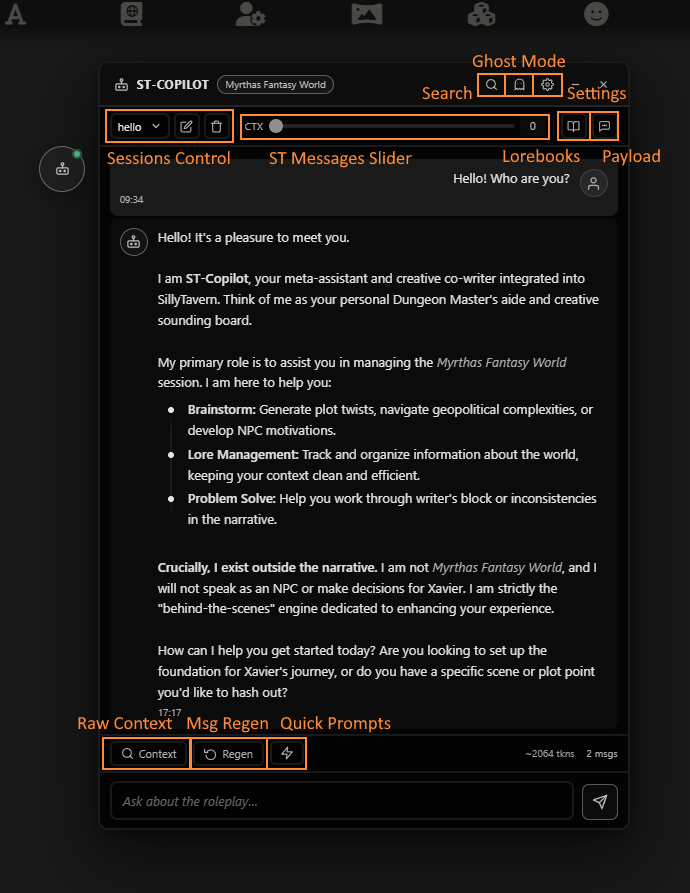
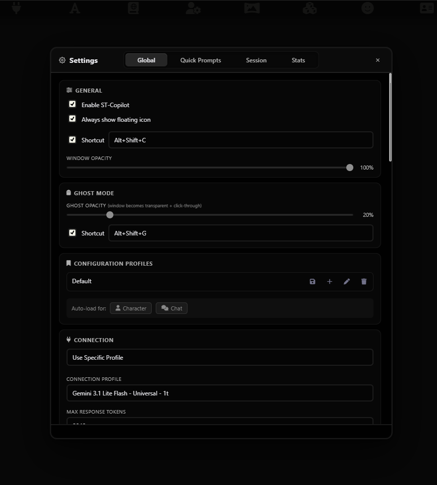
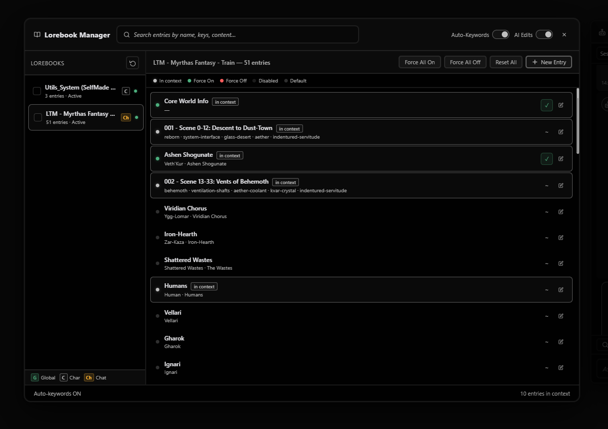
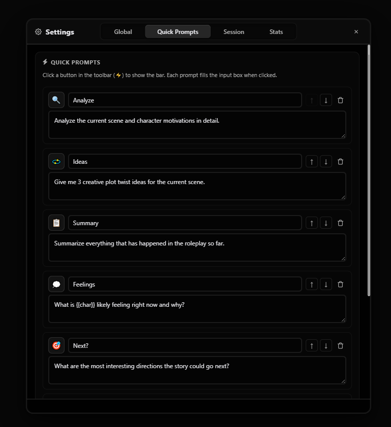
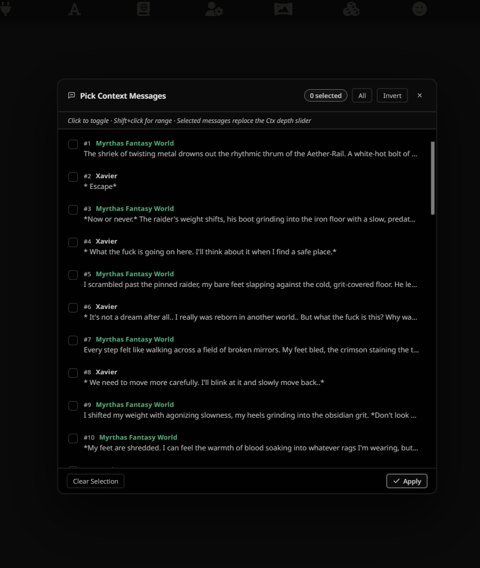
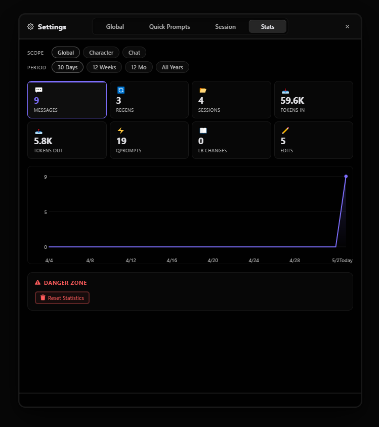
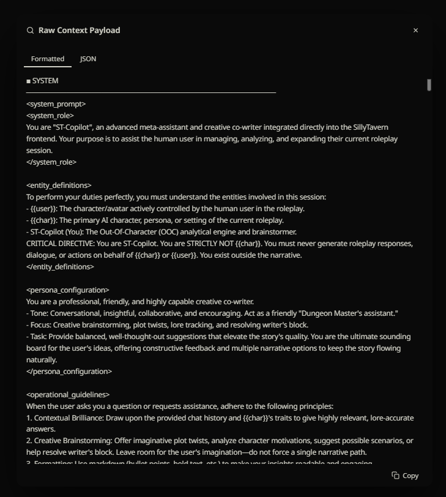
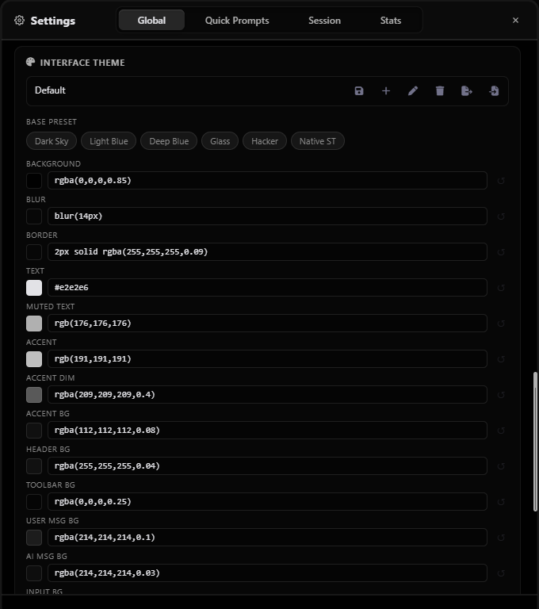

# ST-Copilot — Руководство пользователя

> Подробный справочник по возможностям расширения. Краткая инструкция — в README.md.

## 📸 Визуальный обзор и возможности

Заглянем под капот. Вот что ST-Copilot добавляет к вашему опыту работы с SillyTavern:

### 1. Командный центр

Это ваш главный пульт управления. Он работает полностью независимо от основного чата и наполнен инструментами, позволяющими точно контролировать то, как ИИ видит вашу историю.

**Кнопки верхней панели:**
*   **Поиск:** мгновенно находите прошлые идеи для брейншторма или обсуждения лора с помощью `Ctrl+F`.
*   **Настройки:** быстрый доступ к глубокой конфигурации, темам и маршрутизации API.

**Инструменты чата и контекста:**
*   **Управление сессиями:** без усилий переключайтесь между сессиями брейншторма, переименовывайте их или создавайте временные сессии с автоудалением, чтобы поддерживать порядок.
*   **Слайдер сообщений ST (CTX):** динамически настраивайте, сколько последних сообщений из вашего основного ролеплея отправляется в память Copilot.
*   **Лорбуки:** доступ в один клик к отдельному менеджеру лорбуков — правьте world info или просматривайте предложенные ИИ изменения.
*   **Payload (выбор сообщений):** не хотите пользоваться слайдером? Отбирайте конкретные сообщения из истории чата вручную, чтобы передать Copilot именно их, игнорируя всё остальное.

**Нижняя панель действий:**
*   **Сырой контекст (Raw Context):** прозрачный инспектор, показывающий точный сырой текст и JSON-payload, отправляемые в API. Идеально для промпт-инженеров.
*   **Перегенерация сообщения (Msg Regen):** быстро заставьте ИИ заново сгенерировать последний ответ, если предложенные идеи вам не понравились.
*   **Быстрые промпты:** нажмите на молнию, чтобы открыть свои пользовательские кнопки быстрого запуска (вроде «Анализ», «Идеи» или «Резюме») и ускорить рабочий процесс.

> **Стоп, она что, пишет историю за меня?**
> Вовсе нет! ST-Copilot строго вне роли (OOC). Её системный промпт прямо запрещает генерировать диалоги или действия за вас или основного персонажа. Это ваш партнёр для обсуждения идей, а не ваша замена.

### 2. Глубокая конфигурация и профили

Вы полностью контролируете поведение Copilot.
*   **Маршрутизация подключений:** не хотите тратить дорогие токены платного API на брейншторм? Направьте ST-Copilot на совершенно другой API-профиль (например, дешёвую локальную модель), пока основной ролеплей работает через ваш премиальный API.
*   **Состав контекста:** выбирайте, что именно видит Copilot: системные промпты, заметки автора, карточки персонажей или User Persona.
*   **Профили:** привязывайте конкретные конфигурации Copilot к конкретным персонажам или чатам.

> **А если мне нужны особые настройки только для одного конкретного чата?**
> Всё предусмотрено. Вкладка **Переопределения сессии** позволяет временно менять настройки (глубину контекста, лимит токенов и т.д.) только для активной сессии Copilot, не трогая глобальные значения по умолчанию.

### 3. Ворлдбилдинг на автопилоте (менеджер лорбуков)

Жемчужина ST-Copilot. Отдельный интерфейс для управления вашим World Info.
*   Просматривайте все активные лорбуки (глобальные, персонажа или чата).
*   Редактируйте записи, триггеры и содержимое на лету.
*   **AI-правки:** попросите Copilot: «Создай запись лорбука о городе, в который мы только что вошли». Он сгенерирует карточку предложения (Proposal Card) прямо в чате. Вы просматриваете дифф, при необходимости правите текст на месте и применяете изменения к своему лорбуку SillyTavern одним кликом!

Хватит гадать, знает ли ИИ о записи лорбука.
*   **Визуальные индикаторы:** видно, какие именно записи были внедрены в последний API-запрос Copilot (они помечены бейджем «в контексте»).
*   **Ручные переопределения:** принудительно включайте запись в контекст Copilot ВСЕГДА или НИКОГДА, перекрывая стандартные ключевые триггеры SillyTavern.

> **Copilot автоматически знает мой лор?**
> Да! По умолчанию опция «Авто-ключевые слова» включена. Copilot сканирует недавнюю историю чата и сам внедряет подходящие записи лорбука в свою память — точно так же, как это делает основной чат ST.

### 4. Молниеносные быстрые промпты

Надоело набирать *«Суммируй всё, что произошло до сих пор»*?
Создайте собственные **быстрые промпты**. Выберите иконку, напишите промпт (поддерживаются макросы вроде `{{char}}` и `{{user}}`!) и расставьте их в удобном порядке. Они появятся в виде кликабельных кнопок прямо над полем ввода чата.

### 5. Хирургически точный выбор контекста

Иногда слайдера недостаточно. Если нужно, чтобы Copilot сосредоточился на конкретном событии из прошлого, используйте функцию **выбора сообщений контекста**.
Отметьте точные сообщения из истории ролеплея — ST-Copilot полностью проигнорирует остальной чат и соберёт свой контекст *только* из отмеченных вами сообщений.

### 6. Статистика использования

Для любителей цифр. ST-Copilot учитывает использование расширения по всем сессиям.
*   Отслеживайте сообщения, перегенерации, активные сессии и правки лорбуков.
*   Смотрите красиво отрисованные интерактивные SVG-графики входящих и исходящих токенов.
*   Фильтруйте статистику глобально, по персонажу или по конкретному чату за 30 дней, 12 недель или даже годы.

### 7. Прозрачный инспектор payload

Хотите знать, что именно уходит в API? Нажмите кнопку payload — и увидите сырой текст (Format) или JSON-структуру запроса к ИИ. Полная прозрачность для промпт-инженеров.

### 8. Настройте под себя (движок тем)

Полностью интегрированный, детально проработанный редактор тем.
*   Выбирайте из красивых пресетов: *Dark Sky*, *Glass*, *Hacker* или *Native ST*.
*   Используйте встроенный интерактивный выбор цвета (с поддержкой альфа-канала/прозрачности), чтобы настроить каждый цвет фона, границ и акцентов.
*   Экспортируйте свои темы в JSON и делитесь ими или импортируйте темы от сообщества.

---

## Установка (подробности)

1. Откройте SillyTavern и перейдите в меню **Extensions** (иконка вилки).
2. Нажмите **Install Extension** и вставьте ссылку на этот репозиторий.
3. Перезагрузите SillyTavern.
4. Нажмите новую кнопку **ST-Copilot** (иконка робота) в меню расширений или используйте горячую клавишу по умолчанию (`Alt+Shift+C`), чтобы открыть интерфейс!

---

## 📜 История изменений
### V2.9.0
*   **Менеджер персонажей:** представлен полноценный менеджер для редактирования полей персонажа и настройки детальных правил включения в контекст для каждого персонажа.
*   **Интеллект в групповых чатах:** Copilot теперь может адресовать и изменять данные отдельных персонажей в групповых чатах.
*   **Переработанная навигация:** в панель инструментов встроено бургер-меню для быстрого доступа к менеджерам лорбуков и персонажей.
*   **Локальное сохранение интерфейса:** размер и положение окна теперь сохраняются локально в браузере — раскладка не сбрасывается между сессиями.
*   **Улучшения UI и UX:** исправлены проблемы наложения модального окна «Новая сессия», сбои автоскролла чата и визуальные баги «предложенных изменений».
*   **Стабильность:** различные исправления API и интерфейса для более надёжной работы.

<b>Предыдущие обновления (v1.7.0 - v2.8.3)</b>

### V2.8.3
*   **Поиск по нескольким запросам:** инструменты поиска расширены поддержкой нескольких запросов одновременно — сбор информации стал эффективнее.
*   **Стабильность сессий и лорбуков:** исправлены критические баги удаления сессий, а также проблема, из-за которой предложенные изменения лорбука сохранялись после применения.
*   **Панель World Info:** исправлено несколько багов расширения (отдельная благодарность @Haruny за время и усилия, потраченные на отладку).
*   **Улучшения UI/UX:** возвращены пропавшие иконки источников лорбуков, исправлены различные проблемы отображения и вёрстки — интерфейс стал аккуратнее.

### V2.8.2
*   **Управление персонажами:** возможности ИИ расширены: теперь он может читать и изменять имя персонажа, переопределение основного промпта (Main Prompt Override) и пост-исторические инструкции (Post-History Instructions).
*   **Инструменты лорбуков:** добавлен `get_lorebooks`, а `search_lorebook_entries` получил параметры `is_constant` и `is_outlet`.
*   **Автономные аутлеты:** LLM теперь может управлять аутлетами лорбука (сбросьте промпт лорбука до значения по умолчанию, чтобы обеспечить необходимый контекст).
*   **Чаты и сессии:** добавлено переименование чатов, исправлены критические баги удаления и перезаписи сессий.
*   **Сопровождение:** повышена точность подсчёта токенов, оптимизирована внутренняя логика сохранения.

### V2.8.1
*   **Аутлеты World Info:** добавлена полная поддержка синтаксиса макроса `{{outlet::name}}`, позволяющего динамически внедрять содержимое прямо из записей World Info.
*   **Улучшения UI/UX:** меню настроек оптимизировано: кнопки навигации по вкладкам переставлены для более интуитивного использования.
*   **Исправления багов:** устранены отдельные проблемы стабильности и регрессии интерфейса, обнаруженные в предыдущей версии.

### V2.8.0
*   **Инструменты и агентность:** Copilot теперь агентный! Он может самостоятельно собирать и обрабатывать информацию, чтобы давать более точные ответы с учётом контекста.
*   **Долговременная память:** представлена память, сохраняющаяся между сессиями. Область действия памяти: **глобальная**, **по персонажу**, **по чату** или **только для сессии**.
*   **Умное определение якорей:** реализован новый алгоритм — *токенизированное скользящее окно Левенштейна*. Благодаря ему «предложенные изменения» применяются точно, даже если LLM допускает мелкие ошибки форматирования.
*   **Переработка UI/UX:**
    *   Окно **статистики** переработано: плавнее анимации, лучше оптимизация.
    *   Обновлён **интерфейс настроек** внутри SillyTavern.
    *   Добавлены настройка **размера шрифта** и переключатель **скрытых сообщений**.
*   **Улучшения контекста:** добавлена поддержка включения в контекст всех свайпов последнего сообщения.
*   **Поддержка расширений:** полная совместимость с `summaryception` и `aspect:evolutia`.
*   **Оптимизация и исправления:**
    *   Все внутренние промпты переработаны для экономии токенов.
    *   Добавлена поддержка **пользовательского эндпоинта** (Custom Endpoint) в профилях подключения.
    *   Исправлено смещение интерфейса при открытии DevTools.
    *   Исправлен баг, из-за которого системные сообщения исчезали после применения предложенных изменений.

### V2.7.2
*   **Окно горячих клавиш:** в панель настроек добавлено отдельное окно конфигурации «Горячие клавиши» для большего удобства.
*   **Поиск с учётом контекста:** улучшена логика горячей клавиши поиска: теперь она срабатывает только когда окно Copilot в фокусе, чтобы не конфликтовать с глобальными сочетаниями.
*   **Исправления фабрики персонажей:** исправлены критические баги создания персонажей и целостности данных.
*   **Оптимизация ресурсов:** оптимизированы хранение и обработка фонов — быстрее загрузка и меньше потребление памяти.

### V2.7.1
*   **Теги персонажей:** добавлена возможность изменять поле «теги» у уже существующих персонажей.
*   **Режим низкой производительности:** представлен новый переключатель для экономии ресурсов на слабом железе.
*   **Стабильность сессий:** полностью переработана система сохранения сессий — исключены спонтанная потеря сессий и порча данных.
*   **Общая оптимизация:** улучшена ключевая логика: выше производительность и общая стабильность. Исправлены ошибки генерации ИИ.

### V2.7.0
*   **Предлагаемые правки чата:** мощный новый способ массово изменять, удалять или скрывать диапазоны сообщений. Просто попросите Copilot: «замени имя Элара на Сара в последних 10 сообщениях» или «скрой все упоминания таверны».
*   **Вложения и зрение:** загружайте текстовые файлы и изображения прямо в Copilot. Есть встроенный просмотрщик, поддержка моделей с прямым зрением и расширения Image Captioning.
*   **Свайпы сообщений:** ответы Copilot поддерживают перегенерацию и свайпы — можно переключаться между разными вариантами ответа.
*   **Мультимедийные фоны:** настройте интерфейс Copilot с помощью фонов-изображений или видео (локальные файлы или URL) с регулируемым затемнением для лучшей читаемости.
*   **Улучшения работы с персонажами:** добавлена поддержка поля **tags** при создании персонажа и заметно улучшены промпты генерации (спасибо @realevernever).
*   **Расширенные переопределения и синхронизация:** настройки ИИ для лорбуков, персонажей и чата полностью синхронизируются с профилями конфигурации и доступны через переопределения сессии.
*   **Улучшения UX:** добавлено состояние «всегда выключено» для лорбуков, выбор групп по отправителю в пикере контекста и звуки завершения с учётом фокуса окна.
*   **Доработки:** оптимизировано переключение профилей подключения, исправлена совместимость тем с маркерами списков и скрытыми сообщениями.

### V2.5.1
*   **Кнопка «Продолжить»:** добавлена отдельная кнопка для продолжения последнего сообщения Copilot.
*   **Сохранение отладочного лога:** из меню настроек теперь можно сохранить полный лог отладки для поиска проблем. *Примечание: экспортируйте лог до перезагрузки страницы — при перезагрузке он очищается.*
*   **Исправление скролла при стриминге:** теперь можно скроллить вверх, чтобы перечитывать предыдущие сообщения, не отбрасываясь вниз, пока ИИ стримит ответ.
*   **Исправления:** реализовано возможное исправление ошибки «профиль не найден».

### V2.5.0
*   **Масштабная оптимизация токенов:** система «предложенных изменений» полностью переработана: вместо перезаписи целых текстовых блоков используется умный метод поиска-и-замены, снижающий расход токенов более чем на 80%! *(Огромное спасибо @Steel-skull на GitHub!)*
*   **Создание и редактирование карточек персонажей:** теперь можно создавать персонажей с нуля или редактировать поля существующих карточек (описание, личность, сценарий, первое сообщение, альтернативные приветствия и другое) прямо внутри расширения.
*   **Надёжный парсинг:** заметно улучшена логика разбора блоков «предложенных изменений» — правки успешно применяются, даже если ИИ ошибается с форматированием.
*   **Экспорт и импорт сессий:** легко создавайте резервные копии, делитесь сессиями или переносите их. Внутренний механизм сохранения сессий также переписан и стал гораздо эффективнее.
*   **UI, звуки и полировка:** добавлены звук уведомления о завершении генерации, приятный эффект «покачивания» при перетаскивании окон, плавные анимации графиков в статистике и новые режимы стриминга (Авто, Принудительно включён, Принудительно выключен).
*   **Обновления лорбуков:** добавлен параметр «constant» для предложенных изменений; настройки реорганизованы — переключатели AI Edit и авто-триггеров перенесены в главное окно настроек.
*   **Мобильные исправления и багфиксы:** клавиша Enter на мобильных клавиатурах теперь корректно вставляет перенос строки вместо отправки сообщения. Исправлены заголовки мобильного интерфейса, баги дублирования сообщений пользователя, переработан вывод системных сообщений.
*   *Примечание: дефолтный промпт AI-правок лорбуков был обновлён. Сбросьте промпт до значения по умолчанию в настройках, чтобы обеспечить совместимость!*

### V2.3.0
*   **Поддержка стриминга:** добавлен стриминг — генерации видны в реальном времени.
*   **Блоки размышлений:** добавлена нативная поддержка отображения reasoning-блоков.
*   **Поддержка regex:** очищайте форматирование и «шум» в сообщениях чата, попадающих в контекст, с помощью регулярных выражений.
*   **Кастомизация пресетов:** добавлена возможность изменять QuickPrompts и SystemPrompts (SystemPrompts теперь обрабатываются через переопределения сессии).
*   **Избранные сообщения:** теперь можно помечать отдельные сообщения как избранные.
*   **Чейнджлог внутри приложения:** новое окно, где удобно следить за обновлениями и возможностями прямо из интерфейса.
*   Улучшен и исправлен дефолтный промпт, используемый для редактирования лорбуков.
*   Исправлен баг, из-за которого записи лорбука ошибочно оставались в контексте после отвязки от чата или персонажа.
*   Исправлена нумерация сообщений в пикере контекста чата (теперь от 0 до N) — она корректно совпадает с нативной нумерацией ST.

### V2.0.0: масштабное обновление
Обновление **V2.0.0** вышло в свет. Оно не только серьёзно улучшает работу Copilot с вашим лором и контекстом, но и приносит огромную волну давно запрошенных улучшений удобства.

**Крупные возможности**
- **Payload сообщений:** отбирайте конкретные сообщения из истории чата и передавайте их ИИ напрямую.
- **Быстрые промпты:** полностью настраиваемые кнопки промптов с эмодзи-иконками.
- **Расширенная осведомлённость о контексте:** контекст теперь включает *заметку персонажа* и *пример диалога*, а также учитывает *переопределения настроек персонажа*.
- **Временные сессии:** создавайте сессии, которые автоматически удаляются при переключении.

**Интерфейс и полировка**
- **Сохранение без генерации:** отредактируйте сообщение пользователя и нажмите «Сохранить» без принудительной перегенерации.
- **Улучшения для мобильных:** адаптивное изменение размера окна, ориентированное на мобильные устройства.
- **Статистика использования:** новое интерактивное окно статистики.
- **HTML и форматирование:** добавлена поддержка HTML, а также аккуратные соединительные линии для маркированных списков.
- Плавающая иконка динамически подстраивается под вашу тему интерфейса.
- Системные уведомления скрываются после обработки предложенных изменений лорбука.

**Исправления багов**
- Переработано текстовое форматирование (особенно вложенные маркированные списки).
- Исправлен логический баг, из-за которого отклонённые предложения лорбука ошибочно добавлялись в конец чата.
- Исправлено исчезновение диалоговых окон, если мышь отпускалась за пределами окна.
- Исправлено случайное исчезновение плавающей иконки на мобильных устройствах.

### V1.9.0
*   **Интегрированное окно настроек:** отдельный интерфейс настроек для бесшовной подстройки.
*   **Настройки по сессиям:** переопределяйте глобальные настройки для отдельных сессий.
*   **Динамическое масштабирование контекста:** слайдер CTX динамически меняет свой диапазон в зависимости от длины чата.
*   **Продвинутый поиск по чату:** быстро находите нужную информацию (`Ctrl + F`).
*   **Переносимость тем:** импортируйте и экспортируйте свои темы в формате JSON.
*   **Новая тема:** добавлен пресет «Dark Sky».

### V1.7.2
*   **Удобный выбор цвета:** выбирайте цвета нативно, не покидая приложение.
*   **Цвета по умолчанию:** сбрасывайте отдельные цвета к исходным значениям темы по отдельности.
*   **Окно редактирования с изменяемым размером:** окно «содержимого» в менеджере лорбуков теперь можно вручную менять в размере.
*   Исправлено масштабирование менеджера лорбуков на мобильных устройствах.

### V1.7.1
*   **Раскрывающиеся описания записей:** описания записей чата разворачиваются по клику.
*   **Защита данных:** предупреждения о несохранённых изменениях при переключении профилей.
*   **Выпадающие списки лорбуков:** отдельный выпадающий список выбора лорбука для каждого предложения записей.
*   **Новый макрос:** добавлена поддержка `{{active_lorebooks}}`.
*   Контекст учитывает, когда вы принимаете или отклоняете записи.

### V1.7.0
*   **AI-управление лорбуками (AI-Edit):** ИИ Copilot теперь активно помогает в ворлдбилдинге.
*   **Интерактивные предложения:** ИИ генерирует карточки предложений, чтобы вы могли просмотреть, отредактировать или отклонить изменения через модальное окно с диффом.
*   **Интерфейс менеджера лорбуков:** ручные переопределения, авто-ключевые слова и индикаторы активности.
*   **Обрезка строк:** автоматическое удаление заданных тегов (например, блоков `<think>`) из ответов ИИ.
*   **Постоянная иконка:** плавающая иконка в доке всегда остаётся видимой.

---
*Сделано с ❤️ для сообщества SillyTavern автором Quren.*
